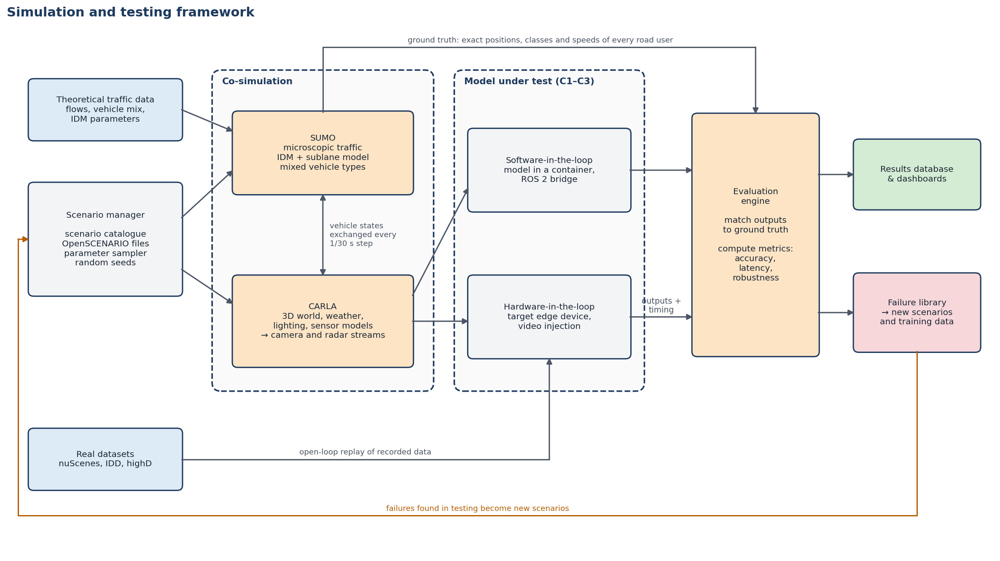
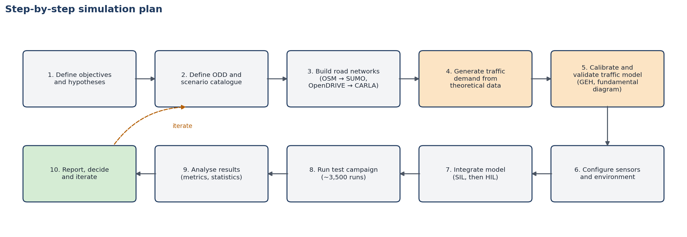
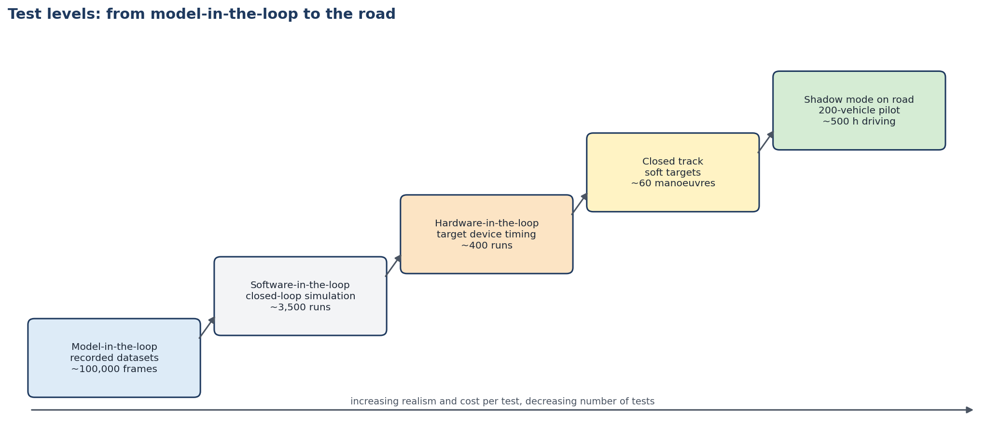
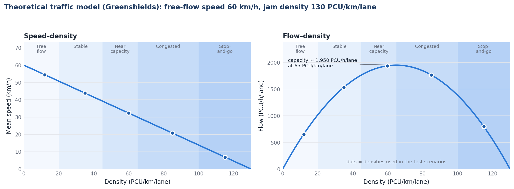
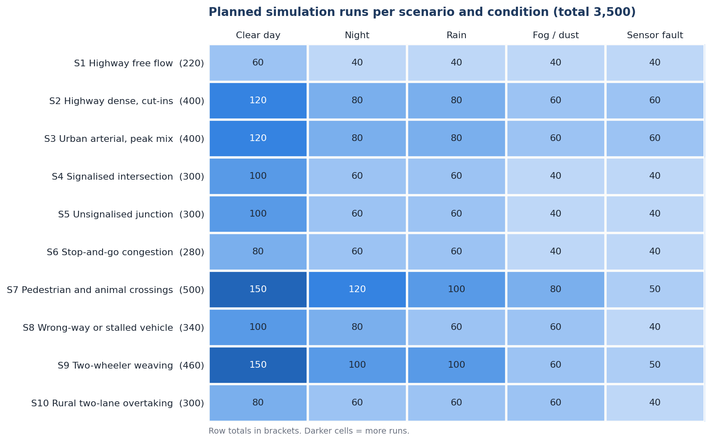

# Simulation and Testing Strategy for AI Algorithms in Traffic Analysis

**Week 4 task, Automotive AI Innovation Internship (YuvaIntern)**

A strategy for simulating Indian traffic and testing the **Saarthi Traffic Analytics Model** before real-time deployment in vehicles. It builds on the [Week 2 sensor fusion study](https://github.com/himshxrmx/sensor-fusion-feasibility-study) and the [Week 3 prototype design](https://github.com/himshxrmx/adas-prototype-conceptual-design).

📄 **Full report:** [Week4_Simulation_Testing_Strategy_Traffic_AI.docx](Week4_Simulation_Testing_Strategy_Traffic_AI.docx)

## The model under test

| Component | What it does |
|---|---|
| C1 Perception and tracking | Detects and tracks vehicles, two-wheelers, pedestrians and animals |
| C2 Traffic-state estimation | Estimates local density, speed and traffic state (free flow → stop-and-go) |
| C3 Prediction and conflict detection | Predicts 3-second trajectories; flags conflicts using TTC, PET and DRAC |

## Framework

**SUMO** (microscopic traffic: IDM car-following, sublane model for lane-free two-wheelers) co-simulated with **CARLA** (3D world, weather, camera and radar models), with the model tested in software-in-the-loop and on the real edge device (hardware-in-the-loop).



## Step-by-step plan



## Test levels



## Traffic from theoretical data

Greenshields speed–density model (free-flow speed 60 km/h, jam density 130 PCU/km/lane, capacity ≈ 1,950 PCU/h/lane) and an assumed Indian vehicle mix (45% two-wheelers in urban traffic). The dots mark the five densities used in testing.



## Test matrix

Ten scenario families × five conditions = **3,500 runs** (about 90 hours of simulated driving).



## Metrics

| Axis | Metrics |
|---|---|
| Accuracy | Precision/recall, mAP, MOTA / IDF1 / HOTA, distance error, traffic-state macro-F1, ADE / FDE, conflict recall |
| Latency | Mean, p95 and p99 end-to-end latency, frame rate, deadline misses, thermal throttling |
| Robustness | Robustness ratio and degradation curves across rain, fog, night, density and sensor faults |

Analysis uses bootstrap confidence intervals, planned sample sizes (≈ 1,825 positives per class and condition for ±1% recall), the rule of three for rare events, paired hypothesis tests and failure-boundary mapping.

## Report contents

Introduction · literature review · methodology (framework, tools, 10-step plan, test levels, theoretical traffic data, calibration with GEH, scenario catalogue, sensor modelling, SIL/HIL) · metrics · data analysis · testing procedures · expected challenges · expected outcomes and go/no-go criteria · 16-week timeline · conclusions · example SUMO configuration · example parameterised scenario.

## Repository contents

```
.
├── README.md
├── Week4_Simulation_Testing_Strategy_Traffic_AI.docx   # the full report
└── images/
    ├── fig1_test_framework.png
    ├── fig2_simulation_workflow.png
    ├── fig3_test_levels.png
    ├── fig4_fundamental_diagram.png
    └── fig5_test_matrix.png
```
