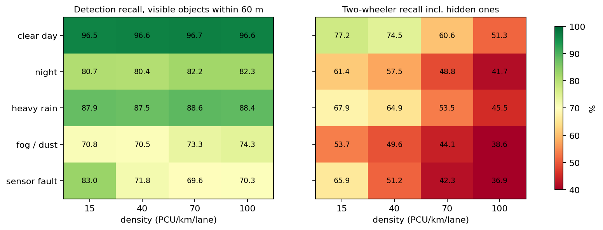
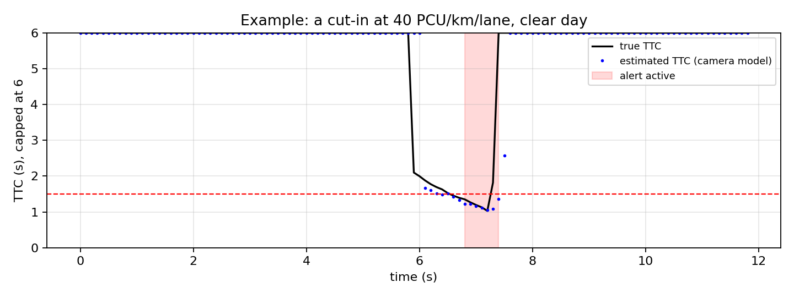

# Simulation and Testing Strategy for AI Algorithms in Traffic Analysis

**Week 4 task, Automotive AI Innovation Internship (YuvaIntern)**

A strategy for simulating Indian traffic and testing the **Saarthi Traffic Analytics Model** before real-time deployment in vehicles, building on the [Week 2 sensor fusion study](https://github.com/himshxrmx/sensor-fusion-feasibility-study) and the [Week 3 prototype design](https://github.com/himshxrmx/adas-prototype-conceptual-design). The strategy was then **run at small scale**: a Python pilot campaign with mixed Indian traffic tests every metric and go/no-go criterion.

📄 **Full report:** [Week4_Simulation_Testing_Strategy_Traffic_AI.docx](Week4_Simulation_Testing_Strategy_Traffic_AI.docx)

## The strategy

SUMO + CARLA co-simulation · 10 scenario families × 5 conditions (~3,500 runs) · 5 test levels from model-in-the-loop to the road · accuracy, latency and robustness metrics · confidence-interval-based decisions.


## Pilot campaign (src/traffic_pilot.py)

- 3-lane ring road, Intelligent Driver Model, **45% two-wheelers / 30% cars / 15% autos / 10% buses and trucks**
- 4 densities (15, 40, 70, 100 PCU/km/lane) × 6 runs × 10 min, the same traffic replayed in **5 conditions** (clear, night, heavy rain, fog/dust, sensor fault)
- ~80 scripted cut-ins and hard-braking events per hour; the ego driver reacts after 0.8–1.5 s
- Statistical stand-in for the camera model: class-pair occlusion, range/condition-dependent detection, distance bias, class confusion, false positives; TTC-based conflict alerts; 30 fps latency model

| Result (clear day unless stated) | Value | Target |
|---|---|---|
| Recall, visible objects ≤ 60 m | **96.6%** | ≥ 95% ✅ |
| Distance error ≤ 40 m | **2.4%** | ≤ 5% ✅ |
| MOTA up to 70 PCU/km/lane | **0.77** | ≥ 0.60 ✅ |
| Severe conflicts (TTC < 1 s) warned | **98 / 98** | all ✅ |
| p99 latency, stop-and-go | **58 ms** (85 ms throttled) | < 100 ms ✅ |
| Robustness ratio night / rain | **0.84 / 0.91** | ≥ 0.75 ✅ |
| Traffic-state macro-F1 | 0.71 | ≥ 0.85 ❌ |
| Conflict recall (95% lower bound) | 97.2% (95.9%) | ≥ 98% ❌ not proven |
| Nuisance alerts in congestion | 4 / h | < 2 / h ❌ |
| Dropped frames, throttled + stop-and-go | 8.7% | < 1% ❌ |

**Decision: CONDITIONAL GO** for the fleet pilot in shadow mode, with a restricted operating domain and the fixes listed in Section 10.2.

Key finding: **occlusion, not the detector, dominates dense traffic.** Two-wheeler recall including hidden ones falls from 77% to 51% between 15 and 100 PCU/km/lane, while recall on visible two-wheelers stays at 95%.




## Repository

```
src/traffic_pilot.py     pilot campaign: IDM traffic, model stand-in, metrics, latency model, figures
src/build_report.py      builds the Word report from the results
src/doclib.py            small python-docx helper
content/base_text.json   reusable text sections of the report
results/                 pilot_runs.csv, pilot_cells.csv, latency.csv, pilot_summary.json
figures/ images/         charts and diagrams
```

## Reproduce

```bash
pip install numpy pandas matplotlib python-docx
python src/traffic_pilot.py      # about 10 minutes
python src/build_report.py
```

The camera model in the pilot is a statistical stand-in with assumed error rates; the pilot exercises the metrics, statistics and go/no-go logic, and the full campaign replaces it with the real model.

---
Him Sharma · Automotive AI Innovation Internship (YuvaIntern) · November 2026
